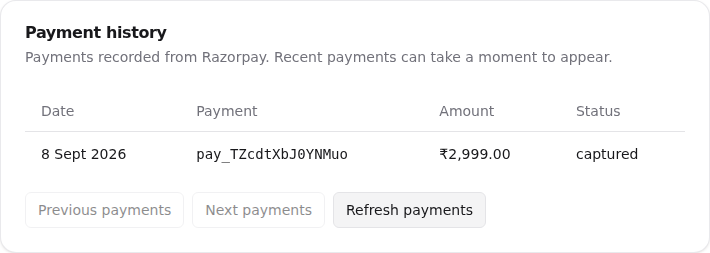
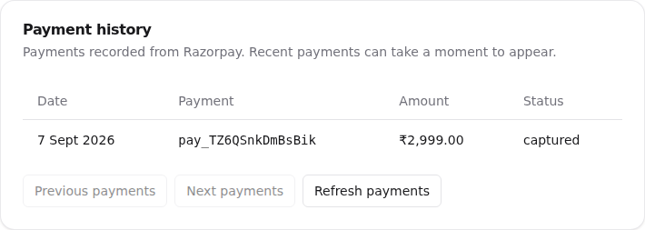

# Billing staging validation

Use a synthetic designer organization and Razorpay **Test Mode**. Staging's webhook and payment-history flow were verified against Razorpay on 8 September 2026; see the E-291 evidence below. This does not certify every scenario in this checklist. Do not use live cards or production keys.

The deterministic suite verifies local PostgreSQL concurrency, authorization, callback signatures, repeated callbacks, cancellation, unchanged-status reconciliation, payment history and UI recovery behavior. `e2e/tests/billing-management.spec.ts` runs real local auth and billing reads with a stubbed Checkout boundary; it does not prove Razorpay connectivity.

1. Configure the staging secret store with `RAZORPAY_KEY_ID`, `RAZORPAY_KEY_SECRET`, `RAZORPAY_WEBHOOK_SECRET` and both paid `RAZORPAY_PLAN_ID_*` values. Use plans from the same Test Mode account. Configure the public API webhook URL `/api/billing/webhook` and the supported subscription/payment events in the Razorpay dashboard.
2. Sign in as the synthetic studio owner. Open Plan & Billing, upgrade Hobby to Professional+, complete the official Test Mode Checkout, and wait for the signed webhook or reconciliation. Confirm the plan stays Hobby if Checkout is dismissed or payment fails. After dismissal, Buy/Upgrade options must be available again. Explicitly choosing the same unused checkout may reuse its subscription ID; choosing another tier must obtain a fresh review and safely supersede the unused attempt.
3. On Professional+, review the immediate Corporate upgrade and its adjustment payment. On Corporate, review the cycle-end Professional+ downgrade. Mandate authorization alone must not grant an unpaid upgrade; deferred downgrades retain current access until the verified end date. Schedule Hobby cancellation and confirm the paid plan stays available to the end date; repeated cancellation must remain idempotent.
   Also review Professional+ immediately after a confirmed Corporate upgrade whose renewal
   mandate is still authenticated. It must quote zero adjustment and the existing paid
   boundary, without a resume-checkout warning. Dismiss an unused downgrade checkout:
   Corporate access and its renewal must remain intact. Authorize the downgrade only on
   an approved Test Mode fixture; verify the future Corporate mandate is cancelled,
   the Professional+ mandate starts at the same boundary, and Corporate access remains
   until then. Unknown cancellation outcomes must reconcile without another purchase.
   Deploy generated migration 0088 before the successor-aware API/worker; see ADR 0017.
4. For an authenticated future-start mandate, active or pending subscription, choose Update Payment Method. Confirm Razorpay opens against the existing subscription ID with `subscription_card_change`. Complete the Test Mode authorization and check the updated status after refresh. Repeated callbacks must not downgrade a webhook-confirmed active status to authenticated. A paid upgrade can legitimately have active Corporate access while its replacement mandate remains authenticated until the next renewal. Updating that mandate must preserve the paid tier, lifecycle and existing renewal boundary. Unsupported provider states must not offer an executable update action, and request errors must appear beside the Billing Summary control.
5. For a halted subscription, use the same recovery control. Confirm it updates the existing mandate. Historical unpaid invoices can still require support intervention: do not represent updating the mandate as paying every old invoice. Test card/UPI/eMandate behavior supported by this account; the hosted payment-failure email link offers the provider's supported method-switching choices.
6. Verify recorded payments, paise-to-rupee conversion and pagination. The history contains signed-webhook transactions, including failures, and may lag until webhook delivery. It does not fabricate invoices, tax amounts, card details or a payment receipt.
7. In an isolated test webhook setup, pause delivery, allow a paid plan/cycle transition, then refresh. The local tier and period end must reconcile even if Razorpay status remains active. Restore delivery afterward. For an original provider replay, use Razorpay's documented support process; a newly created webhook may not be eligible for older events. Transaction IDs must stay unique. Never disable a shared webhook to isolate one subscription.
8. Try each billing API as an unauthenticated caller and as an organization member without billing permission. Confirm no billing changes, checkout configuration or payment history are available. Simulate API failure: billing should display unavailable/last loaded information, never a fabricated Hobby downgrade.

Sources: [Razorpay payment retries and card changes](https://razorpay.com/docs/payments/subscriptions/payment-retries/), [subscription updates](https://razorpay.com/docs/api/payments/subscriptions/update-subscription/), [Test Mode subscriptions](https://razorpay.com/docs/payments/subscriptions/test/).

The development-only `subscribe-demo` route remains inaccessible in production; all production billing actions use `CheckoutFlow` or the existing-subscription payment recovery flow.

## Authenticated replacement card change — 17 October 2026

Read-only staging inspection of QA Complete Designer's QA Blue Verification studio
found active Corporate access backed by a captured upgrade adjustment, with its
replacement `sub_TogEhtF650gYN4` still authenticated and scheduled for 17 November
2026 at 00:00 IST. The deployed payment-method endpoint excluded authenticated
mandates, returning 409 before Checkout opened.

A temporary local diagnostic page exercised the real Razorpay Checkout SDK with
the staging merchant's **Test Mode public key**, this existing subscription ID and
`subscription_card_change: true`. Razorpay accepted the documented sandbox
Mastercard ending 5558 and returned payment `pay_ToxJxDMINcbPhO`. Server-side HMAC
verification passed; the provider reported its INR 500-paise authorization fully
refunded. The subscription remained authenticated, `start_at` remained unchanged,
and staging readback retained active Corporate access and the same renewal date.
No live payment, new subscription, provider activation or database repair was used.

This verifies Razorpay's real card-change boundary for an authenticated mandate;
it is not a claim that the application fix was deployed during this check. Local
regressions cover the API, signed callback, unchanged paid access, UI eligibility,
dismissal/retry and inline feedback. After deployment, repeat the application
button path on this state to confirm it no longer returns 409.

## Checkout abandonment and pricing navigation

Follow [ADR 0016](../adr/0016-billing-checkout-abandonment-and-pricing-navigation.md).
Deploy additive migration `0087_tearful_logan.sql` before the API and worker.
It retains superseded provider checkout identities for compensation; unresolved
records also prevent organization retention from deleting reconciliation state.

Verify on desktop and mobile:

- Manage Subscription, Upgrade, reactivation, restore and saved-plan review open
  `/designer/plan-billing/subscribe`. Plan comparison renders on that subpage;
  selecting a plan opens a subscription confirmation dialog. Closing the dialog
  clears the selection and returns to pricing. The table never appears inside
  the dialog.
- Close an unused checkout, return to billing, and reopen plans. Buy/Upgrade
  options are available and no previous browsing selection is restored. Repeat
  using browser Back, reload and an old session-storage selection.
- Choose a different paid tier after closing checkout. Confirm the old provider
  ID is retained in `billing_abandoned_checkout`, the new checkout has a distinct
  identity, and replaying the old operation cannot resume the retired attempt.
- Leave an unused paid-plan replacement, then choose Hobby cancellation. The
  existing paid access lasts through its verified period end; the unused upgrade
  reservation must not prevent cancellation.
- Deliver late authorization/charge evidence for a superseded attempt in the
  isolated provider test setup. It must not change entitlements. Confirm worker
  cancellation/refund reconciliation and that a failed provider request retries
  without losing the retired identity or processing later candidates incorrectly.
- An already authorized mandate, adjustment payment or uncertain create outcome
  remains under confirmation/recovery. Navigation alone must not create a second
  financial agreement or claim that an in-flight payment failed.

The local billing browser suite uses a deterministic provider simulator and
does not establish real merchant sandbox settlement. Repeat the applicable
provider checks against the configured Razorpay Test Mode account before rollout.

## Active subscriptions with an unverified period

An active provider status does not establish a current paid period. Before quoting
an upgrade or scheduling Hobby cancellation, selection checks that the provider
period contains the quote timestamp and uses valid integer timestamps. An expired,
reversed, future or malformed period blocks confirmation with
`billing_period_unverified`; it does not fabricate a renewal date or change the
current entitlement. Missing periods continue to use the existing paid-plan
recovery flow, while cancellation remains blocked until its end date is verified.
The shared server/client billing view model suppresses an expired or malformed
active-period date without changing the tier, lifecycle or access. The overview
shows that its renewal date is awaiting confirmation; historical dates in failed
payment states remain available. Verify this display alongside the preview guard.

On 9 October 2026, read-only checks of the staging QA designer found that both the
local subscription and Razorpay Test Mode reported active status with a period
ending on 8 October at 00:00 IST. Corporate preview raised `Invalid paid billing
period`, and Hobby preview offered cancellation at that past date. Regression
tests reproduce these boundaries. After deployment, repeat both previews: they
must return a blocked review without a 500, charge, past effective date or past
next-renewal promise. When Razorpay supplies a valid current period, existing
proration and cancellation flows become available again. Provider lifecycle
repair must use actual provider events/state; do not extend dates in the database.

## E-291: verified staging payment history

The active Test Mode webhook `TZcMan7wCDwJ2S` targets
`https://staging.tickif.com/api/billing/webhook`. Readback confirmed these six
events, matching `RAZORPAY_EVENT` in `packages/contracts/src/billing.ts`:

- `subscription.activated`
- `subscription.charged`
- `payment.failed`
- `subscription.pending`
- `subscription.halted`
- `subscription.cancelled`

The older webhook `TVy7gzuF3VVmcN` targeted
`https://e57f-103-191-62-77.ngrok-free.app/api/billing/webhook` and was left
unchanged. The staging endpoint rejected an unsigned probe with 401. A correctly
signed unsupported event returned 200/ignored without changing billing data.

| Check                        | Evidence                                                                               | Result                                                                                                                         |
| ---------------------------- | -------------------------------------------------------------------------------------- | ------------------------------------------------------------------------------------------------------------------------------ |
| Fresh provider delivery      | Real staging Checkout, subscription `sub_TZ7RQwMQ9mBQFK`, payment `pay_TZcdtXbJ0YNMuo` | Razorpay captured INR 299,900 paise; API and rendered history showed one captured ₹2,999 row before operator redelivery.     |
| Duplicate handling           | Two signed operator redeliveries using verified provider entities for that payment     | Both returned 200/duplicate; exactly one payment remained.                                                                     |
| Original missing transaction | Payment `pay_TZ6QSnkDmBsBik`, subscription `sub_TZ6McgaGBZEwGW`                        | Recovery returned 200/processed; repeat returned 200/duplicate. API and UI showed one captured ₹2,999 row dated 7 September. |
| Subscription preservation    | Full subscription response before and after each recovery/duplicate check              | Unchanged, including entitlements, period end and scheduled cancellation.                                                      |

The historical recovery used an **operator-generated** `subscription.charged`
envelope containing payment and subscription entities fetched with authenticated
Razorpay Test Mode API calls. It was signed with the matching webhook secret and
sent through the existing webhook handler. Before sending, the operator verified
captured status, invoice/payment/subscription relationships, organization, amount,
currency and the current local subscription. No direct database insert was used.
This was not a replay of an original provider event. The separate fresh purchase
establishes actual provider delivery; the operator requests establish recovery
and idempotency. Do not reuse this procedure for arbitrary lifecycle events or
production recovery without reviewing their state effects.

The supplied superadmin account had no organization memberships. Its supported
Better Auth impersonation API provided access to the existing test designer
organizations without changing account roles or membership. Verification used
`GET /api/billing/payments?limit=20&offset=0` and `/designer/plan-billing`.

Razorpay CLI 1.0.9 has no webhook/replay command. Original-event replay requires
the [documented Razorpay support process](https://razorpay.com/docs/webhooks/faqs/),
including its event-age and webhook-enablement restrictions. The configuration
was applied through the authenticated provider API. Credentials and sessions are
not included in this repository. No application code change or deployment was
needed to resolve E-291.
